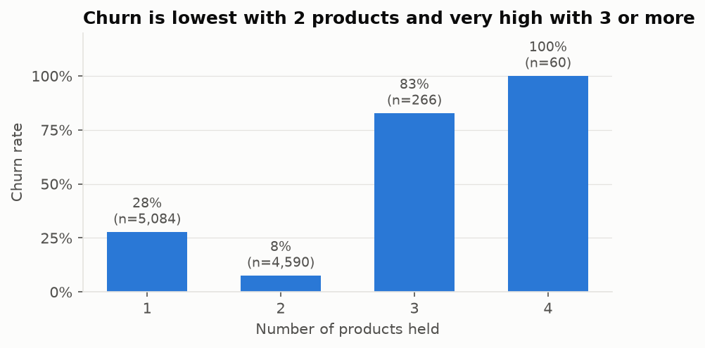
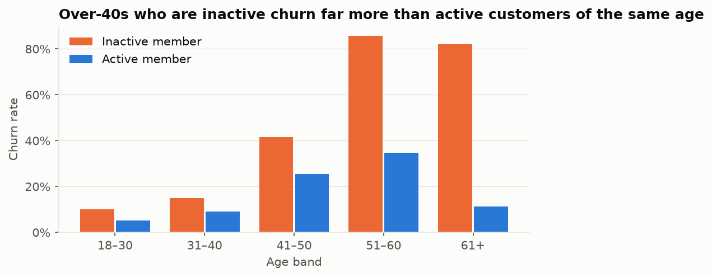
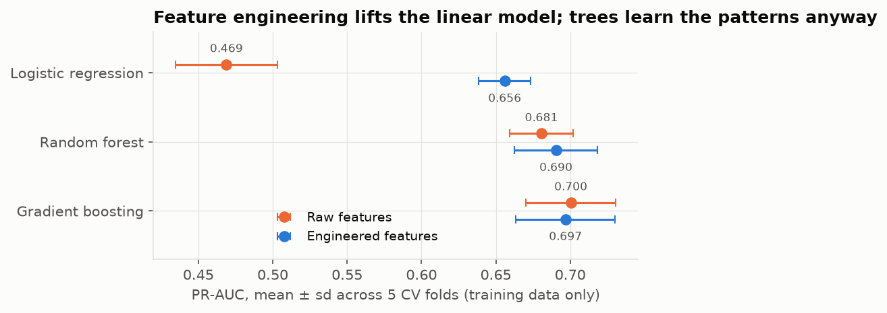
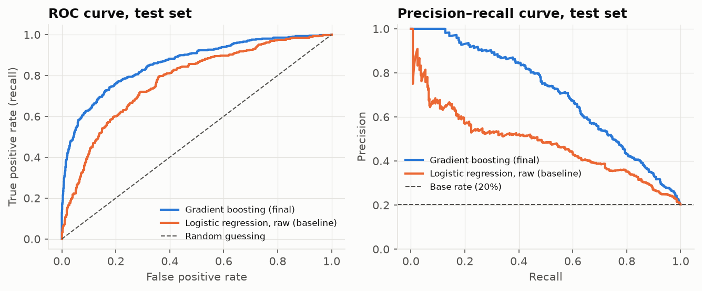
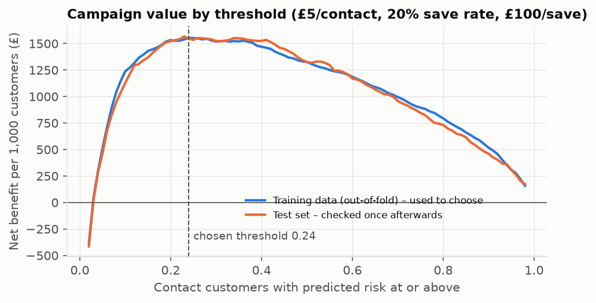
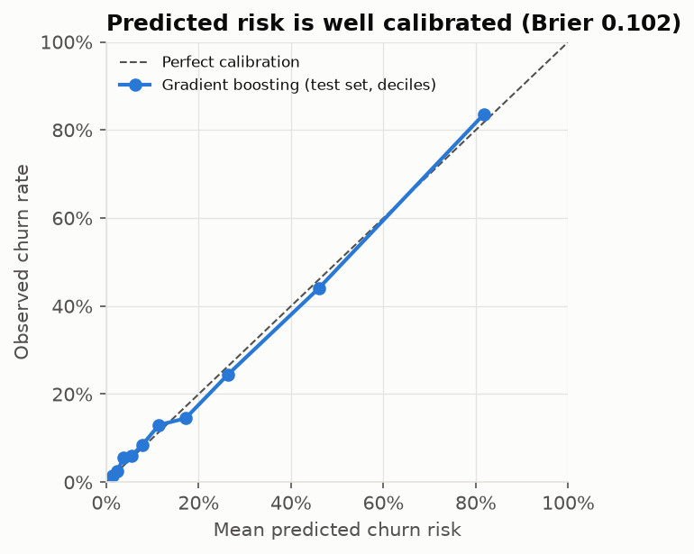
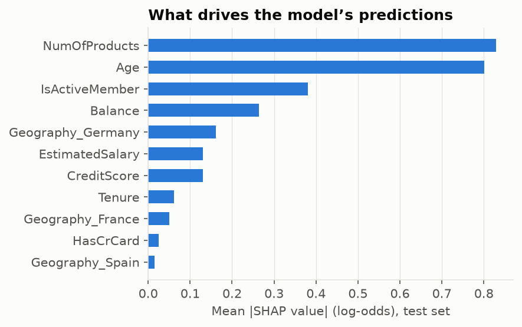

# Customer Churn Prediction for Retention Targeting

**Which bank customers should a retention team contact, and is the campaign worth running?**

This project predicts which of a bank's customers are likely to leave, then turns those predictions into a contact list that maximises the value of an (illustrative) retention campaign. Models are chosen with cross-validation, the test set is used only once, the predicted probabilities are checked for calibration, and the model is audited for differences across gender, country and age groups.

🔗 **Live app:** https://freddiehw-churn-model.streamlit.app/

| | Result on 2,000 held-out test customers |
|---|---|
| Final model | Gradient boosting (scikit-learn `HistGradientBoostingClassifier`), Gender excluded |
| PR-AUC | **0.705** (plain logistic regression baseline: 0.479; random guessing: 0.20) |
| ROC-AUC | **0.860** (baseline: 0.775) |
| Calibration | Brier score 0.102; predicted risk matches observed churn across deciles |
| Campaign value | **£3,090** net benefit with the cost-based threshold, vs £2,655 at the default 0.5 threshold, £2,020 for the baseline model, and −£1,860 for contacting everyone |

---

## 1. Question

A retention offer (a call, a fee waiver) costs money, and most customers were never going to leave. The useful question is not "who will churn?" but **"who is worth contacting?"** So the project has two parts:

1. Rank customers by churn risk as accurately as possible, and make sure the probabilities are trustworthy.
2. Choose a contact threshold from the campaign's costs, instead of the default 0.5 cut-off.

## 2. Data

- Public **Bank Churn Modelling** teaching dataset ([YBI Foundation on GitHub](https://github.com/YBI-Foundation/Dataset/blob/main/Bank%20Churn%20Modelling.csv)). 10,000 customers of a European bank in France, Germany and Spain, with a 20.4% churn rate.
- Target: `Churn` (renamed `Exited`), 1 if the customer closed their account.
- Features: credit score, country, gender, age, tenure, balance, number of products, credit-card flag, active-member flag, estimated salary. `CustomerId` and `Surname` are identifiers and are never used.
- No missing values and no duplicate customers. The code downloads the CSV on first run; the data itself is not committed.
- **Caveats:** this is a widely used teaching dataset with no documented collection date, definition of "active" or churn window, so results may not carry over to a real bank.

## 3. What the data shows



- **Product count has a U-shaped effect.** Two products is the safest group (8% churn). Three or more is the riskiest (83–100%). A linear model can't represent this with a single coefficient.
- **Age and activity interact.** Churn peaks in the 51–60 band, and among customers over 60, inactive ones churn at 82% vs 11% for active ones.
- **Germany churns at 32%**, about double France and Spain. Oddly, no German customer has a zero balance, which looks like a feature of how the dataset was put together.
- Salary, credit score, tenure and having a credit card show almost no relationship with churn on their own.



## 4. Method

**Split.** One stratified 80/20 split: 8,000 training and 2,000 test customers, fixed random seed. The test set is not looked at until the final model and threshold are fixed.

**Leakage control.** Feature engineering, imputation, scaling and one-hot encoding all sit inside a single scikit-learn `Pipeline`, so in every cross-validation fold they are fitted only on that fold's training data.

**Feature engineering.** Based on the findings above, five features were added: `ZeroBalance`, `Products2`, `Products3Plus`, `AgeSquared` (lets a linear model bend with age), and `InactiveOver40`.

**Model selection.** Three models (logistic regression, random forest, gradient boosting) × four feature sets (raw or engineered, each with and without Gender) = 12 combinations, each scored with 5-fold stratified cross-validation. The winner is the one with the **highest mean PR-AUC**, chosen because with 20% positives, PR-AUC focuses on how well the model finds churners. Accuracy is misleading here: predicting "nobody churns" scores 80%.

**No class weighting.** Re-weighting classes distorts predicted probabilities. Here the imbalance is handled where it matters, at the decision threshold, so the probabilities can be used directly in the cost calculation.

**Gender rule, set before seeing results:** keep Gender only if it improves CV PR-AUC by more than one standard error across folds.



**Findings from model selection:**
- Feature engineering lifts logistic regression from 0.469 to 0.656 PR-AUC, which confirms the analysis above found real non-linear patterns.
- It adds nothing for the tree models (gradient boosting: 0.700 raw vs 0.697 engineered), because trees learn those splits themselves. So the final model uses the simpler raw feature set.
- Gender improved gradient boosting's PR-AUC by 0.003, well below the 0.014 standard error, so **Gender was dropped**.

**Threshold.** Each contact costs £5. A contacted customer who would have churned is kept with probability 20%, worth £100. These are illustrative assumptions you can change in the app. The threshold that maximises net benefit is chosen on the **out-of-fold predictions from the training data**, giving **0.24**. As a sanity check, for a calibrated model the break-even point is cost ÷ (save rate × value) = 5 ÷ 20 = **0.25**.

## 5. Results (test set, used once)



| Threshold | Precision | Recall | Customers contacted | Net benefit |
|---|---|---|---|---|
| 0.50 (default) | 75.9% | 48.6% | 261 | £2,655 |
| **0.24 (cost-based)** | 53.9% | **70.8%** | 534 | **£3,090** |

The lower threshold accepts more wasted contacts in exchange for reaching 90 more churners, which pays off when a contact is cheap compared with a saved customer. The profit curve is fairly flat between about 0.2 and 0.4, so the main lesson is that **0.5 is too strict for these economics**. The exact optimum matters less. The test-set curve closely follows the training curve, so the choice holds up on new data.



**Calibration.** Predicted probabilities line up with observed churn rates across deciles (Brier 0.102), so a "30% risk" really means about 30%. That is what makes the cost-based threshold valid.



**Explainability.** SHAP values (TreeExplainer) show product count and age drive most predictions, followed by activity status and balance. The app shows a per-customer SHAP breakdown. These explain the *model*, not what *causes* customers to leave.



## 6. Fairness check (test set, threshold 0.24)

| Group | Customers | Actual churn | ROC-AUC | Recall | False positive rate |
|---|---|---|---|---|---|
| Female | 930 | 25.1% | 0.863 | 70.8% | 15.5% |
| Male | 1,070 | 16.3% | 0.859 | 70.7% | 15.4% |
| France | 1,021 | 17.1% | 0.845 | 64.0% | 12.4% |
| Germany | 504 | 30.0% | 0.861 | 81.5% | 26.9% |
| Spain | 475 | 17.1% | 0.864 | 65.4% | 11.7% |
| Age 18–30 | 399 | 6.3% | 0.750 | 28.0% | 4.0% |
| Age 41–50 | 492 | 35.0% | 0.822 | 80.2% | 36.6% |

(Full table, including all age bands, is in `reports/results.json` and the app.)

- **Gender:** after removing Gender, recall and false positive rates are nearly identical for men and women. Average predicted risk for women (21.7%) is still below their actual churn rate (25.1%), so part of the difference isn't explained by the other features.
- **Germany:** German customers are contacted about twice as often and have twice the false positive rate. Some of this reflects genuinely higher churn, but Geography could also stand in for other factors. A real campaign should check the offers made to this group.
- **Age:** the model is weakest for under-40s, where churners are rare. Age is a protected characteristic under the UK Equality Act. It is kept here because it's a strong predictor and a retention offer is low-stakes, but a real deployment would need compliance sign-off.

## 7. Limitations

- **Teaching dataset.** It has an unknown time period and definitions, and the German balance pattern suggests it may be partly synthetic.
- **Possible leakage in `IsActiveMember`.** If "active" was recorded near the time of churn, it partly describes the outcome rather than predicting it. Its definition isn't documented.
- **Campaign economics are assumptions.** The calculation assumes contact only affects customers who would otherwise churn, at a fixed save rate. Measuring real uplift needs a randomised experiment (A/B test) or an uplift model.
- **One split, little tuning.** Hyperparameters are sensible defaults, not tuned. Tuning would need nested cross-validation to keep the evaluation honest.
- **No time dimension.** Every customer is a single snapshot, so the model can't say *when* someone will leave.

## 8. Next steps

1. Tune gradient boosting with nested cross-validation and report confidence intervals on test metrics (bootstrap).
2. Build an uplift model, which predicts who is *persuadable* rather than who is at risk, and is a better basis for targeting.
3. Test whether results hold on a different churn dataset.

## Run it

```bash
python3 -m venv .venv
source .venv/bin/activate           # Windows: .venv\Scripts\activate
pip install -r requirements-dev.txt
python train.py                     # reproduces every number and figure above (~30 s)
                                    # and saves artifacts/results.joblib for the app
pytest -q                           # 19 tests
streamlit run app.py
```

## Project structure

```
data_utils.py     load, validate and feature-engineer the dataset
model_utils.py    pipelines, cross-validation, threshold optimisation, calibration, fairness, SHAP
train.py          full experiment -> reports/results.json, reports/figures/, models/
app.py            Streamlit app: overview, model selection, test results, fairness, explanations, strategy
tests/            pytest checks: data validity, leakage safety, gender exclusion, profit arithmetic
reports/          results and figures (committed)
artifacts/        saved model + results the app loads at start-up, so it never retrains (committed)
                  data/ and models/ are rebuilt by the code and not committed
```

**Tools:** Python, pandas, scikit-learn, SHAP, Plotly, Streamlit, matplotlib, pytest.
